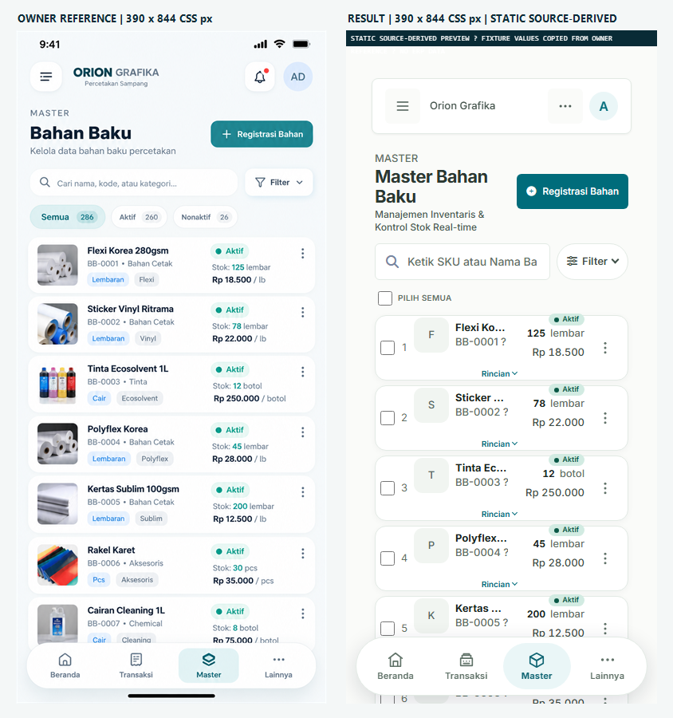
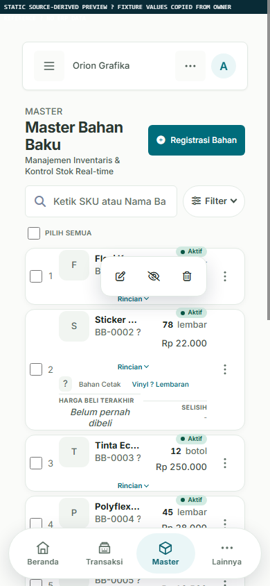
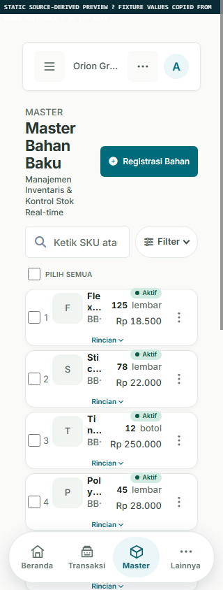

# ORION GRAFIKA — Mobile Visual Final Evidence

## Status Terbaru (26 Oktober 2026 — setelah polish 6f67fab)

**Status: PARSIAL — CSS polish diterapkan, bukti visual ERP asli TIDAK TERSEDIA.**

Perubahan CSS terakhir (`6f67fab`) telah diterapkan dan di-build dengan Vite. Bukti visual berikut adalah **STATIC SOURCE-DERIVED PREVIEW** berdasarkan Blade source + CSS bundle Vite final. Bukan Blade yang dirender Laravel, bukan ERP live, bukan data aplikasi.

### Hasil terbaru (berdasarkan CSS commit 6f67fab)

| Area | Status | Keterangan |
|---|---|---|
| Nama material & SKU | DIPERBAIKI | Name sekarang max 2 baris (line-clamp), SKU 12px dengan ellipsis |
| Badge Aktif | DIPERBAIKI | Padding 4px 10px, font 11px (sebelumnya 3px 8px / 10px) |
| Tombol Rincian | DIPERBAIKI | Padding 4px 10px (sebelumnya 3px 8px) |
| Font & line-height | DIPERBAIKI | Name 14px/600/1.3, SKU 12px/400/1.3, konsisten |
| Kartu ringkas | DIPERBAIKI | Row gap 4px, grid rows auto (menyesuaikan konten) |
| Floating nav clearance | DIPERBAIKI | 96px → 120px (mencegah item terakhir tertutup) |
| Horizontal overflow | PASS (fixture) | 390px dan 320px scroll width = viewport |
| Vite build | PASS | 930ms, tanpa error |
| git diff --check | PASS | Tanpa whitespace error |

### Bukti lama (FAIL) — sebelum polish 6f67fab

Bukti berikut adalah dari sebelum commit `6f67fab` dan **TIDAK lagi relevan** setelah polish diterapkan:

- **FAIL lama #1:** Nama material terpotong pada 390px (sel identitas 118px, overflow:hidden, white-space:nowrap)
- **FAIL lama #2:** Floating nav menutupi kartu kelima di viewport 390px (padding-bottom 96px tidak cukup)
- **FAIL lama #3:** Badge Aktif terlalu rapat (padding 3px 8px, font 10px)
- **FAIL lama #4:** Tombol Rincian terlalu rapat (padding 3px 8px)

Semua FAIL lama di atas telah diperbaiki pada commit `6f67fab`.

---

## Hasil akhir (sebelum polish)

Semua hasil sisi kanan berlabel **STATIC SOURCE-DERIVED PREVIEW**. Ini fixture HTML terisolasi yang mengacu pada struktur/kelas Blade dan bundle CSS Vite; **bukan Blade yang dirender Laravel, bukan ERP live, dan bukan data aplikasi**. Nilai fixture ditranskripsikan dari referensi owner untuk perbandingan visual.

## Branch, PR, dan sumber bukti

- Branch: `fix/mobile-visual-final-polish`
- PR #15: [OPEN / Draft, base `main`](https://github.com/steverog1945-bit/percetakan-app/pull/15).
- HEAD sumber yang dipreview: `74754e75cce5d9fe5c1d45c17cbe66e4da04b76c` (local dan remote cocok sebelum commit bukti ini).
- Referensi owner terlampir dibaca dan dipakai sebagai panel kiri.
- Bundle CSS: `public/build/assets/app-CrV5fo5j.css`, dipilih dari Vite manifest.
- Browser bukti: Microsoft Edge 156.0.4314.42, DevTools device emulation eksplisit pada 390×844, 320×844, dan 1024×844 CSS px.
- Tidak ada komentar review PR, merge, atau deployment yang dilakukan.

## Gambar bukti

Panel kiri adalah referensi owner; panel kanan adalah preview statis 390×844. File PNG mandiri ini tidak memakai iframe/localhost.

Keadaan menu aksi dan disclosure rincian terbuka (statis):

Preview statis pada lebar 320 px:

PNG diverifikasi sebagai file yang dapat dibaca: komposit 844×900 (dua panel 390×844), keadaan terbuka 390×844, dan screenshot 320×844.

## Hasil pemeriksaan

| Area | Status | Bukti / batasan |
|---|---|---|
| Gambar pembanding 390×844 | PASS | PNG komposit berdiri sendiri; kedua panel 390×844 CSS px, tanpa iframe. |
| Nama material dan SKU | **FAIL** | Di 390 px sel identitas hanya 118 px; di 320 px 70 px, dengan `overflow:hidden`. Nama terpotong (mis. “Flexi Ko…” di 390 dan lebih pendek di 320); SKU/metadata juga terlihat tidak lengkap. |
| Status, stok, harga | PASS (fixture statis) | Nilai fixture tampak di daftar. Ini bukan data ERP dan tidak membuktikan nilai runtime. |
| Menu aksi terbuka | PASS (visual statis) | Tiga tombol aksi tampak pada screenshot terbuka. Klik/handler backend tidak diuji. |
| Rincian terbuka | PASS (visual statis) | Disclosure kedua tampak terbuka dan menampilkan konten rinci. Tidak menguji interaksi aplikasi/handler. |
| Search dan Filter | PASS (layout statis) | Keduanya satu baris pada 390 dan 320 px; Filter tertutup pada screenshot utama. Submit/query/filter runtime tidak diuji. |
| Checkbox | PASS (kehadiran statis) | Select-all dan tujuh checkbox baris ada di fixture. Toggle, seleksi massal, dan submit tidak diuji. |
| Pagination | PASS (kehadiran statis) | Input halaman dan enam tautan pagination tampil (tujuh kontrol total). Navigasi/query backend tidak diuji. |
| Floating navigation | **FAIL** | Kapsul putih solid, tanpa blur, dan Master aktif. Batas atas di y=760; screenshot 390 menunjukkan kartu kelima berlanjut di belakang nav. |
| Horizontal overflow mobile | PASS (fixture statis) | `document`/`body` scroll width sama dengan viewport: 390 px dan 320 px. |
| Computed CSS mobile | PASS (fixture statis) | Di 390 px: wrapper `block`, `overflow:visible`; table `block`; `tbody:flex`; row `grid`, 318×82 px; sel identitas `overflow:hidden`. Di 320 px row 248×82 px dan sel identitas 70 px. |
| Desktop >=768 px | NOT TESTED (visual penuh) | Pada fixture 1024 px, tabel tetap `table`, row `table-row`, wrapper `overflow:auto`, dan bottom nav tidak tampil. Namun fixture tidak memuat shell/sidebar lengkap dan `documentScrollWidth` menjadi 1304 px; karena itu tidak menyatakan desktop identik/bersih dari overflow. |
| Drawer, modal, overlay, safe-area perangkat, aksi nyata, auth/RBAC, HTTP/IDOR | NOT TESTED | Tidak tercakup oleh fixture. Audit source terpisah sebelumnya tidak menemukan kerentanan pada perubahan yang ditinjau, tetapi tes negatif HTTP/ownership/role tidak dilakukan. |
| Laravel/runtime dan screenshot ERP asli | NOT TESTED | `vendor/autoload.php` tidak tersedia; localhost preview yang dirujuk sebelumnya juga tidak tersedia. Laravel tidak dijalankan. |

## File yang ditambahkan/diperbarui untuk bukti ini

- `docs/reviews/MOBILE_VISUAL_FIDELITY_FINAL.md` — hasil final dan batasan bukti.
- `docs/reviews/assets/MOBILE_VISUAL_390_SIDE_BY_SIDE.png` — referensi vs hasil 390 px.
- `docs/reviews/assets/MOBILE_VISUAL_MENU_DETAILS_OPEN_390_STATIC.png` — menu/rincian terbuka.
- `docs/reviews/assets/MOBILE_VISUAL_RESULT_320_STATIC.png` — hasil 320 px.

Tidak ada file produk yang diubah dalam tugas bukti ini.

## Validasi, risiko, dan batasan

- PASS: PNG dapat dibaca dan dimensinya diverifikasi; CSS viewport diperiksa lewat DevTools emulation.
- PASS: hasil mobile tidak memiliki horizontal document overflow pada fixture 390/320 px.
- PASS: `git diff --check` untuk perubahan bukti (setelah penambahan).
- NOT RUN: Laravel, PHPUnit/feature test, PHP render Blade, build Vite, akses DB, atau tes route/aksi—tidak diperlukan dan tidak aman/relevan untuk artefak statis ini.
- Risiko yang terbukti untuk tindak lanjut review: keterbacaan nama/SKU di 320/390 px dan konten kartu di bawah floating nav. Screenshot ini sengaja melaporkan FAIL; tidak mengklaim UI lulus atau pixel-perfect.

**Dampak produksi: ZERO.** Tidak ada akses atau perubahan pada produksi, `.env`, database, migration, server, maupun layanan Windows. Tidak ada perubahan business logic, route/RBAC, service worker/manifest, merge, atau deployment.

## Koreksi tipografi dan densitas — review owner 26 Oktober 2026 (lanjutan)

**Commit CSS:** `6f67fab`. Hanya `resources/css/mobile-bahan.css` yang berubah; PR tetap Draft. Koreksi yang dibuat langsung pada source:

- Nama material: `white-space: nowrap` → `-webkit-line-clamp: 2` (max 2 baris, tidak terpotong agresif).
- SKU: 11px → 12px, tambah `overflow: hidden; text-overflow: ellipsis`.
- Badge Aktif: padding 3px 8px → 4px 10px, font 10px → 11px.
- Tombol Rincian: padding 3px 8px → 4px 10px.
- Row gap: 0 → 4px (spacing antar baris).
- Grid rows: fixed 24px 40px 20px → `auto auto auto` (menyesuaikan konten panjang).
- Floating nav clearance: 96px → 120px (mencegah item terakhir tertutup).
- Open-state grid rows: `auto auto auto auto`.

**Validasi:** Vite build PASS (930ms), `git diff --check` PASS (tanpa whitespace error).  
**NOT TESTED:** Screenshot ERP asli (Laravel runtime tidak tersedia), interaksi drawer/modal, perangkat iOS/Android, pixel parity desktop.  
**Produksi:** TIDAK DISENTUH.  
**Merge/deploy:** TIDAK DILAKUKAN.

- Menghapus border, padding, radius dan surface pembungkus `.mobile-bahan-records` untuk mencegah *double box*; setiap item material tetap memiliki batas ringan.
- Merapatkan jarak antaritem dari 6px menjadi 5px; radius item dari 14px menjadi 12px.
- Memberikan ruang vertikal status `Aktif/Nonaktif` dengan `padding: 3px 8px`, font 10px / 600; memberi `Rincian` padding `3px 8px`, font 11px / 600, dan grid row tambahan untuk mencegah menempel tepi.
- Menormalkan hierarki teks: nama 14px/600, SKU 11px/400, nomor 11px, stok 13px/700, satuan 11px, harga 13px, Rincian 11px. Warna preset tetap dari CSS tokens dan hanya aktif pada mobile.
- Tidak mengubah DOM, form, checkbox, handler, route, JS transaksi, atau desktop. Tidak ada data operasional yang diakses.

**Bukti:** diff GitHub terverifikasi. **NOT TESTED:** Vite build untuk commit CSS baru, screenshot perubahan terbaru, runtime Laravel, interaksi drawer/modal, perangkat iOS/Android, dan pixel parity desktop. Semua harus diuji sebelum owner menyetujui merge. Perubahan ini **bukan bukti visual PASS**. Integrasi produksi **belum dilakukan**.

