# Orion Grafika — Galeri Tipografi Form & Filter (PR #22)

Bukti visual **nyata** dari Blade Laravel yang dijalankan di staging terisolasi
(Chromium/Playwright), bukan mockup HTML. Semua gambar di bawah adalah PNG asli
yang tersimpan di `docs/reviews/assets/pwa-mobile-typography/`.

## Provenance (asal bukti)

| Item | Nilai |
|---|---|
| Branch | `fix/form-filter-month-typography` |
| Base commit (main, sebelum PR) | `b9aaec5` |
| Implementasi tipografi | Kode existing PR #22 (`02ed233`, `0f9a52f`) — dipakai ulang, bukan dibuat ulang |
| Route | `GET /kasir/monitoring` → `kasir.index` |
| Halaman | Monitoring Kasir (filter disubmit: `tgl_mulai=2026-10-01&tgl_selesai=2026-10-31&status_filtered=1`) |
| Role uji (sintetis) | `kasir` (Operator Produksi) |
| Tema | Light (Theme Manager default) |
| Lingkungan | `APP_ENV=staging`, database SQLite terisolasi `orion_pwa_staging_pr21` (file sementara, bukan produksi) |
| Server | `php artisan serve` 127.0.0.1:8000, aset Vite hasil `npx vite build` |
| Browser | Chromium headless (Playwright), render Blade asli |
| Data | Sintetis (`StagingFixtureSeeder`), 5 transaksi contoh |

Login nyata berhasil (`/masuk` → `/dashboard` → `/kasir/monitoring`). Halaman
yang difoto **bukan** halaman login.

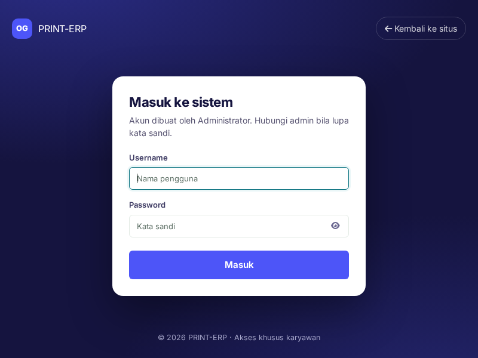

## BEFORE vs AFTER — halaman & filter yang sama

BEFORE = CSS dari base `b9aaec5` (tanpa `form-typography.css`).
AFTER = CSS branch ini (dengan `form-typography.css`).

### Desktop 1366px — filter terbuka

| BEFORE | AFTER |
|---|---|
| 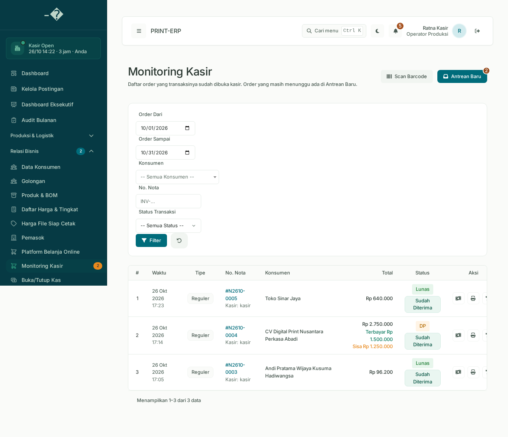 | 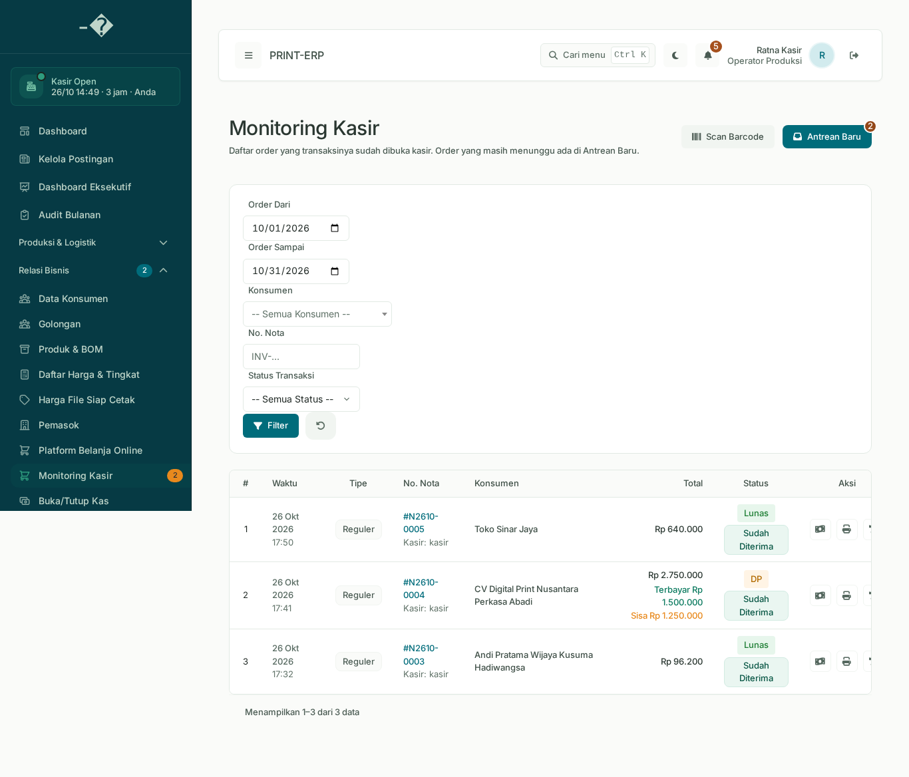 |

Perbedaan terukur: tinggi glif input filter **13px → 14px** (standar input desktop).

### Mobile 390px — filter terbuka

| BEFORE | AFTER |
|---|---|
| 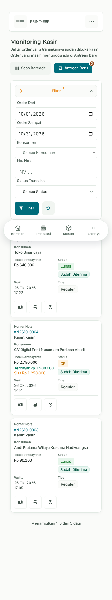 | 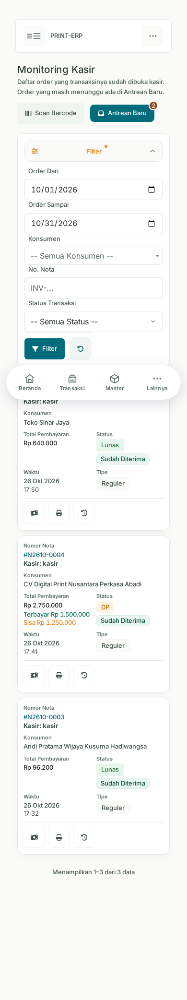 |

Mobile sudah memakai 16px (aturan lapisan `mobile-ui`); PR menjaga nilainya.

## Tangkapan multi-viewport (AFTER)

| 320 | 360 | 390 | 430 |
|---|---|---|---|
| 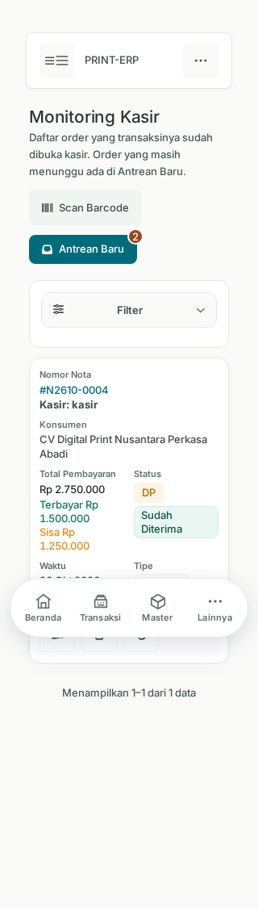 | 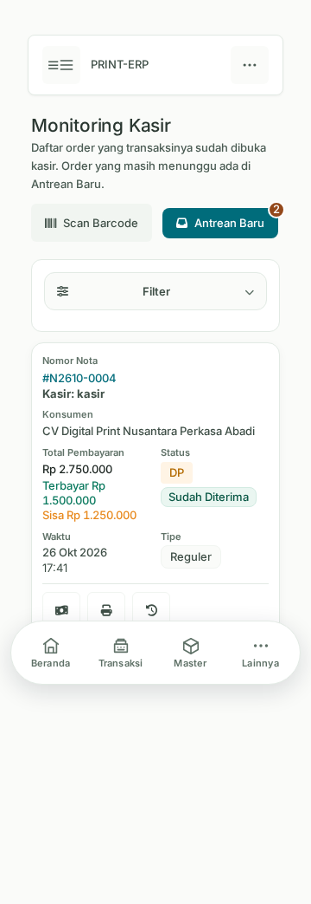 | 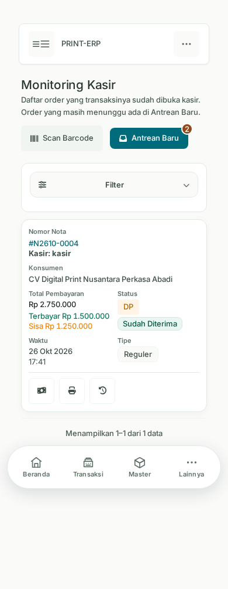 | 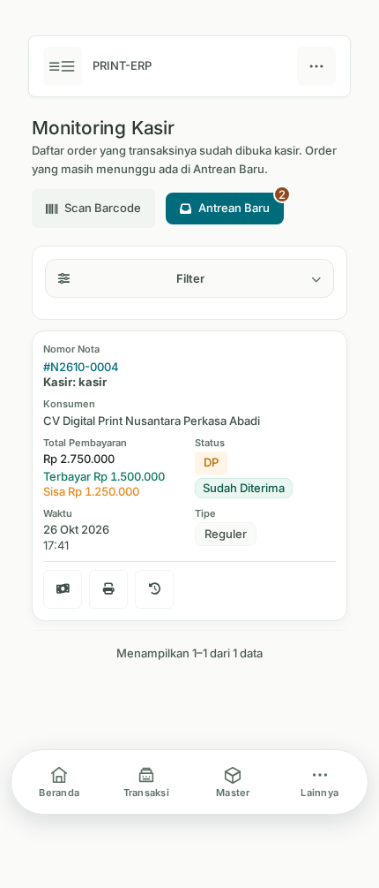 |

| 768 | 1024 | 1366 |
|---|---|---|
| 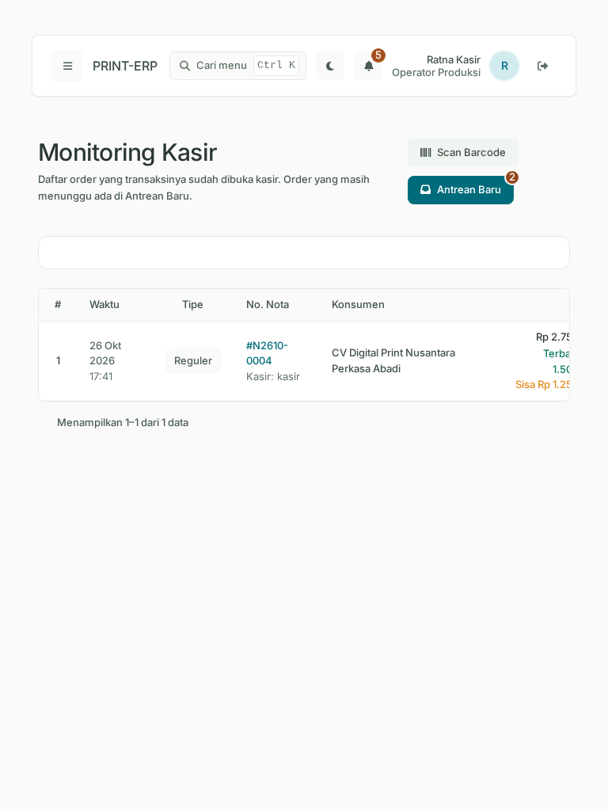 | 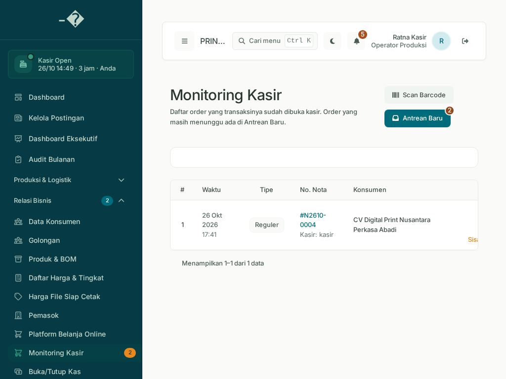 | 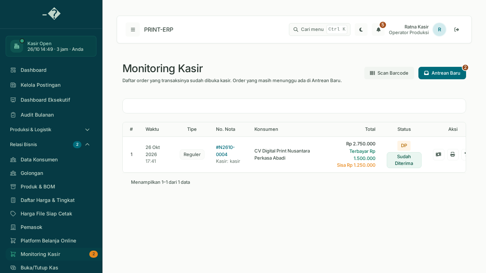 |

## Computed style terukur (getComputedStyle)

Sumber: `computed-before.json`, `computed-after.json`, `computed-styles.json`.

| Properti | Standar | BEFORE 390 | AFTER 390 | BEFORE 1366 | AFTER 1366 | Hasil |
|---|---|---|---|---|---|---|
| Input font-size | 16 mobile / 14 desktop | 16px | 16px | **13px** | **14px** | PASS |
| Input font-weight | 400 | 400 | 400 | 400 | 400 | PASS |
| Input font-family | Font Theme Manager | Inter | Inter | Inter | Inter | PASS |
| Label font-size | 13px | 13px | 13px | 13px | 13px | PASS |
| Label font-weight | 500 | 500 | 500 | 500 | 500 | PASS |
| Select font-size | 16 mobile / 14 desktop | 13px (base) | 16px | 13px (base) | 14px | PASS |
| Table header | 13px / 500 | 13/500 | 13/500 | 13/500 | 13/500 | PASS |

## Root cause & perbaikan

1. Sebelumnya ukuran kontrol mengikuti token `.text-sm` Theme Manager (13px)
   sehingga input/select desktop menyimpang dari standar 14px.
2. `resources/css/form-typography.css` (implementasi existing PR #22) menormalkan
   seluruh `input/select/textarea` menjadi 14px desktop / 16px mobile lewat
   variabel `--erp-form-control-size`, label 13px/500, bobot 400, line-height
   1.45, serta mengatur Select2 dan `::-webkit-datetime-edit`. Field yang
   sengaja besar dikecualikan (`:not(.text-lg)` / `data-typography-preserve`).
3. Import dipastikan berada di posisi valid (setelah `mobile-ui.css`), bukan di
   akhir file, dan `mobile-ui.css` tetap terimpor sehingga CSS mobile PWA utuh.
4. Native date/month picker tetap mekanisme browser (tidak diganti).

## Catatan / residual

- Halaman yang diuji: Monitoring Kasir (fokus PR). Halaman lain belum difoto
  pada sesi ini → **NOT TESTED** untuk modul lain.
- Kartu filter dalam keadaan tertutup (collapse) tampil sebagai kotak kosong
  tipis di desktop — perilaku `
` yang sudah ada sebelumnya, di luar
  lingkup tipografi; tidak diubah.
- Tidak ada akses `.env`/`oriondb`/produksi. Staging memakai SQLite sementara.
