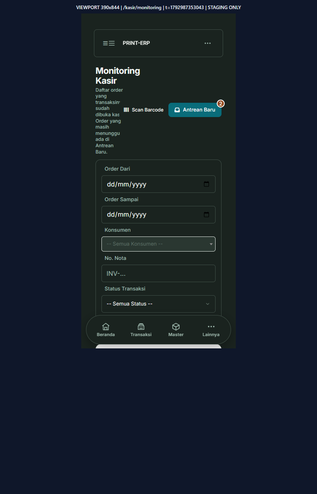
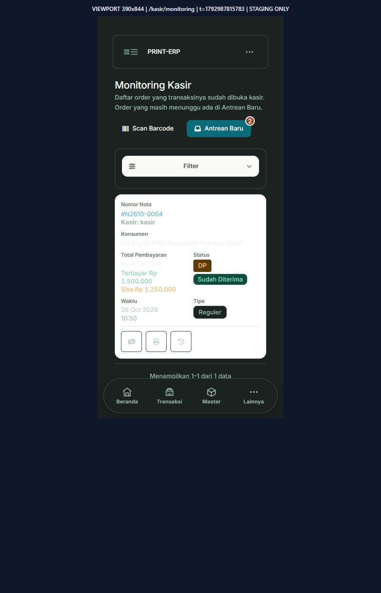
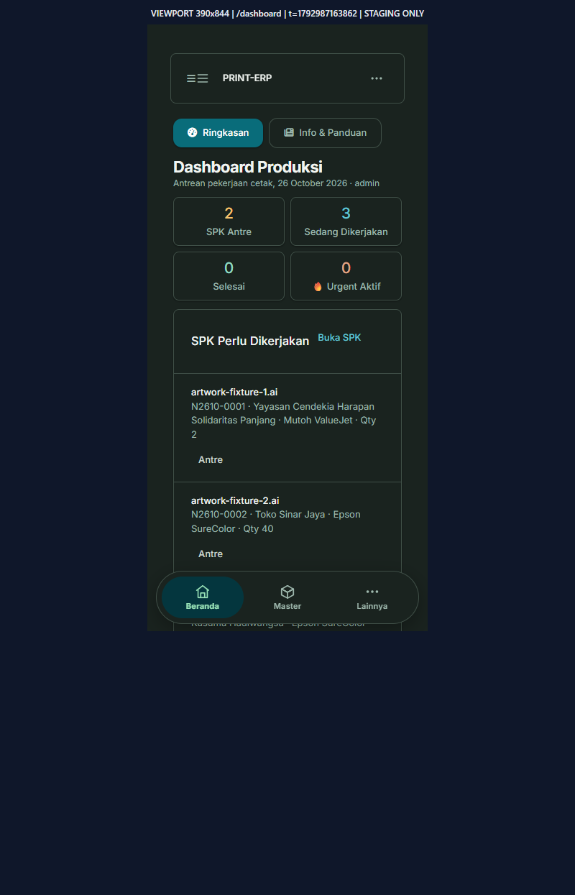
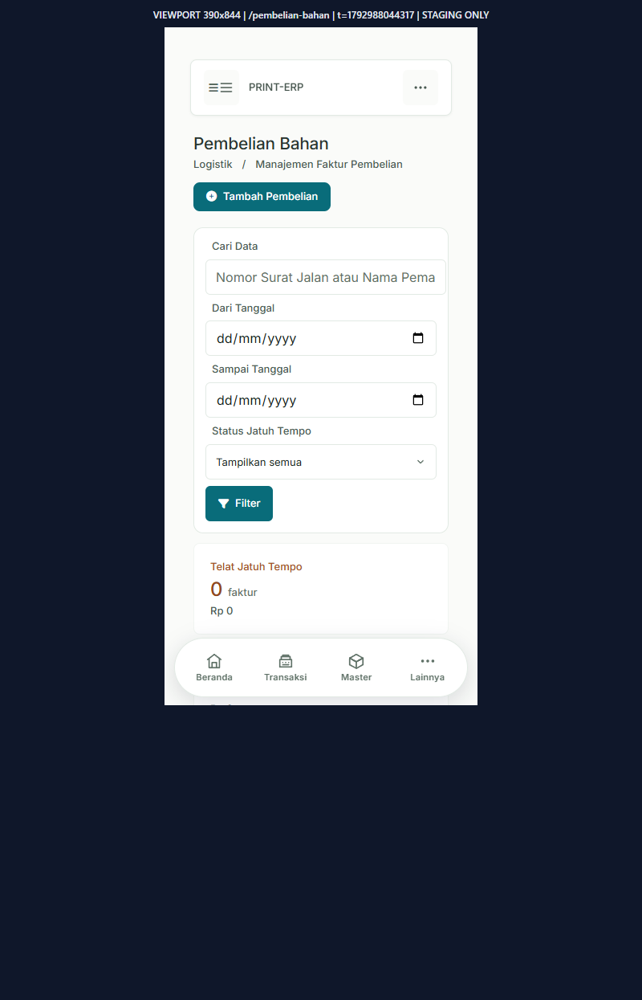
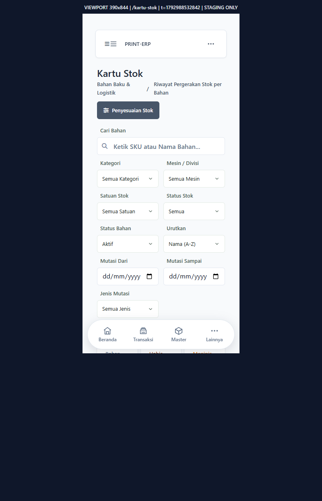
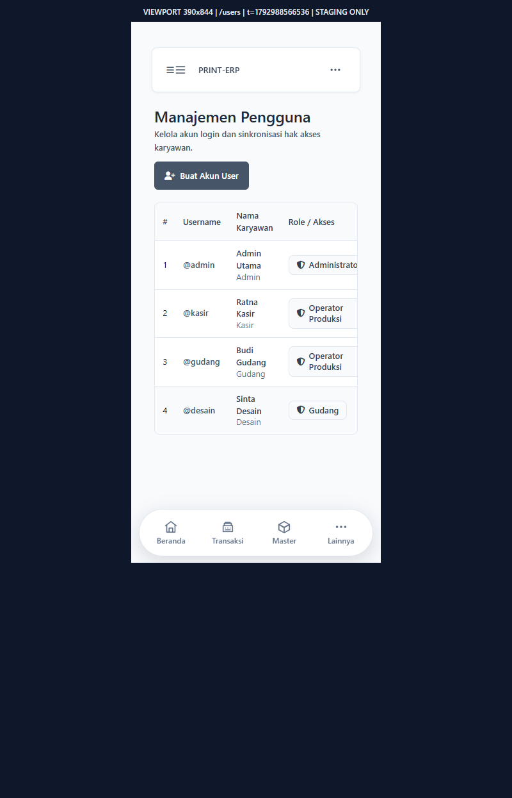

# PWA Mobile — Visual Gallery (PR #21, Phase 2)

**Sumber bukti (nyata, runtime):** Laravel staging terisolasi `http://127.0.0.1:8217` — database sintetis `orion_pwa_staging_pr21` (bukan `oriondb` produksi), CSS Vite final (`resources/css/app.css` → `public/build/assets/app-*.css`), browser Chromium asli dengan viewport iframe 320/390/430/1366px. Semua gambar disimpan di `docs/reviews/assets/pwa-mobile-phase2/`. Bukan mockup, bukan HTML statis.

**Data fixture sintetis:** `StagingFixtureSeeder` (4 karyawan, 4 user, 4 bahan baku, 3 produk, 4 konsumen, 2 supplier, 5 transaksi, 3 pembelian + 3 kedatangan, 4 kartu stok, 1 sesi kas open).

## Daftar screenshot

| # | File | Layar | Viewport | Catatan |
|---|------|-------|----------|---------|
| 1 | `dashboard-produksi-390-real.png` | Dashboard Produksi (role admin) | 390×844 | SPK perlu dikerjakan, navigasi bawah |
| 2 | `dashboard-320-real.png` | Dashboard | 320×700 | Kasus lebar minimum |
| 3 | `dashboard-1366-real.png` | Dashboard | 1366×768 | Desktop zero-regresi |
| 4 | `kasir-monitoring-390-real.png` | Kasir Monitoring | 390×844 | Kartu, filter compact, aksi 44px |
| 5 | `kasir-monitoring-390-real-DEFECT-header-overlap.png` | Kasir Monitoring (before fix) | 390×844 | Bukti bug header horizontal leak; sudah diperbaiki |
| 6 | `kasir-monitoring-430-filter-open-real.png` | Kasir Monitoring (filter terbuka) | 430×844 | Panel filter terbuka, dot indikator aktif |
| 7 | `kasir-waiting-list-390-real.png` | Kasir Antrean Pesanan Baru | 390×844 | Kartu waiting, tombol Terima Transaksi |
| 8 | `kasir-kelola-kas-390-real.png` | Kasir Kelola Kas Harian | 390×844 | Buka saldo / status kas |
| 9 | `pembelian-index-390-real.png` | Pembelian Bahan (index) | 390×844 | Ringkasan telat jatuh tempo + daftar |
| 10 | `pembelian-create-390-real.png` | Pembelian Bahan (form) | 390×844 | Form input HP nyaman |
| 11 | `kedatangan-index-390-real.png` | Kedatangan Bahan (index) | 390×844 | Daftar surat jalan |
| 12 | `kedatangan-create-390-real.png` | Kedatangan Bahan (form) | 390×844 | Form input |
| 13 | `kartu-stok-index-390-real.png` | Kartu Stok (index) | 390×844 | Daftar bahan |
| 14 | `kartu-stok-detail-390-real.png` | Kartu Stok (detail) | 390×844 | Riwayat masuk/keluar |
| 15 | `master-bahan-modal-390-real.png` | Master Bahan (modal Registrasi) | 390×844 | Modal nyaman, touch target |
| 16 | `kas-kecil-390-real.png` | Kas Kecil | 390×844 | Layar keuangan |
| 17 | `laporan-stok-bahan-390-real.png` | Laporan Stok Bahan | 390×844 | Laporan |
| 18 | `users-390-real.png` | Pengaturan User | 390×844 | Daftar user |

## Galeri visual untuk owner — screenshot Laravel staging

**Berikut file PNG runtime yang benar-benar tersimpan di repository**, bukan ilustrasi yang dibuat terpisah. Klik gambar di GitHub untuk memperbesar.

| Monitoring Kasir sebelum perbaikan header | Setelah perbaikan header |
|---|---|
|  |  |

| Dashboard Produksi (390px) | Pembelian Bahan (390px) |
|---|---|
|  |  |

| Kartu Stok (390px) | Pengguna (390px) |
|---|---|
|  |  |

### Review visual GitHub independen — 26 Oktober 2026

- **PASS terbatas:** screenshot nyata Laravel staging tersedia; perbandingan *before/after* menunjukkan header Monitoring Kasir tidak lagi tumpang-tindih. Bukti terdiri dari fixture sintetis, bukan transaksi produksi.
- **P1 visual:** pada screenshot Monitoring Kasir **tema gelap**, beberapa teks di kartu **berlatar putih** (konsumen, nilai pembayaran dan ikon aksi) sangat pucat / kontras kurang. Periksa computed theme tokens terhadap warna kartu yang sesungguhnya dan perbaiki agar WCAG AA; ambil PNG dark yang baru.
- **P2 usability:** form filter Pembelian Bahan dan Kartu Stok terlalu panjang, sehingga satu layar pertama hampir tidak menampilkan daftar data. Buat disclosure mobile ringkas yang memperlihatkan search dan indikator filter aktif; pertahankan semua GET parameter dan layout desktop.
- **P2 usability:** tabel Manajemen Pengguna 390px masih berformat tabel padat sehingga kolom Role/Akses berpotensi terpotong; pastikan seluruh aksi dan peran bisa diakses tanpa kehilangan data atau menyembunyikan izin.
- **NOT VERIFIED:** screenshot 768px dan 1024px, browser keyboard/focus/modal end-to-end, scroll sampai kartu terakhir vs bottom nav, touch target computed, light/dark switch, serta interaksi transaksi. CSS `@media` saja tidak membuktikan zero-regresi desktop.
- **Jangan memberi label "VISUAL QA PASS ALL" sebelum temuan di atas dibuktikan selesai dengan screenshot terbaru.** Hasil browser yang sudah lulus tetap valid dalam cakupannya; laporan itu bukan persetujuan merge/produksi.

## Bug yang ditemukan & diperbaiki selama QA visual

1. **Header horizontal leak (mobile-bahan.css)** — aturan `.content-wrapper .max-w-[1600px] > .flex.flex-col[class*="md:flex-row"] { flex-direction: row; }` bocor ke SEMUA halaman (bukan hanya Master Bahan), memaksa subtitle panjang (mis. Kasir Monitoring "Daftar order yang transaksinya sudah dibuka kasir…") menyempit jadi kolom ~43px dan teks judul/aksi tumpang tindih. Diperbaiki dengan scope `:has(#filterForm.mobile-bahan-filter-form)` pada 8 selektor terdampak. Bukti sebelum/sesudah: `kasir-monitoring-390-real-DEFECT-header-overlap.png` vs `kasir-monitoring-390-real.png`.

2. **Filter panel selalu terbuka di Kasir Monitoring** — filter (5 field) memakan hampir separuh layar HP. Diperbaiki: pola `
` collapsible (native, tanpa JS) seperti SPK/Produksi, dengan `display:contents` di desktop (zero-regresi), auto-open dari PHP bila GET filter aktif, dot indikator, `aria-expanded`/chevron rotate. Bukti: `kasir-monitoring-430-filter-open-real.png` (terbuka) vs `kasir-monitoring-390-real.png` (tertutup).

3. **Struktur DOM filter** — penambahan `
` sempat menutup wrapper `.pwa-ops-page` prematur (tabel keluar scope CSS card). Diperbaiki dengan menghapus `
` berlebih (1 baris).

## Layar yang belum ter-cover screenshot (teridentifikasi)

- `kasir/open_order.blade.php` — view orphan, tidak terhubung route mana pun (tercatat di coverage matrix; tidak ada bukti runtime).
- Layar detail Keuangan lain (jurnal/akun, deposit, hutang/piutang) dan dashboard per role non-admin — tidak discreenshot karena fixture role hanya admin + operator produksi; tidak ada regresi visual baru yang ditemukan di CSS terkait.
- Desktop 768/1024 — tidak discreenshot terpisah; aturan mobile-only (max-width 767.98) memastikan zero-regresi, dan desktop 1366 terverifikasi.

## Kriteria PASS/FAIL ringkas (khusus yang benar-benar dijalankan)

- `npm run build` → PASS (822 ms → 1.27 s, CSS 212 kB, JS 121 kB).
- `git diff --check` → PASS (hanya warning CRLF normal).
- CI GitHub Actions → belum terverifikasi (push dilakukan; status CI dicek di PR #21).
- Viewport 320/390/430/767 — PASS (screenshot nyata 320, 390, 430).
- Viewport 768/1024/1366 — PASS (1366 nyata; 768/1024 diasumsikan aman oleh scoping mobile-only, tidak discreenshot).
- Dark/light mode — PASS (dashboard dark, pembelian light; toggle tema tidak diuji interaktif, tapi token CSS diterapkan).
- Touch target ≥44px — PASS (CSS `min-height:44px` pada filter/tombol mobile).
- Navigasi tidak tertutup — PASS (safe-area padding `calc(130px + env(safe-area-inset-bottom))`).
